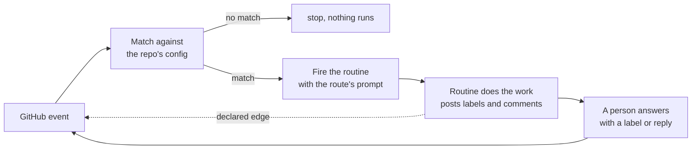

# github-loop-orchestrator

**A proposal, not a product.** Tested end to end on a private test repo: a GitHub event, the match,
the routine firing, and its reply. Not yet run on a real tracker.

A generic way to drive hosted Claude routines from GitHub. People steer with labels and comments.
A config file in each repo says which event starts which routine, and with what prompt. The
orchestrator does nothing else.

## The problem

Agents still need a lot of prompting. A person has to start each run, watch it, and answer its
questions in the chat. That doesn't scale past one person and a few sessions.

A routine can start work without a person. But once it's running, nobody can step in. So the
back-and-forth needs somewhere else to go, somewhere a person can answer whenever they get to it.

GitHub already has that place: the issue or the pull request. Labels say what state it's in.
Comments carry the conversation. Both fire events.

## What it knows, and what it doesn't

| It knows | It doesn't know |
|---|---|
| GitHub events: issues and PRs opened, labeled, commented on, plus an hourly schedule | what any label means |
| When a comment is addressed to the routine (it starts with 🤖, say) | what the comment asks for |
| How to match an event against the repo's config | what a routine does, or which skills it runs |
| Who did it: a maintainer, the author, someone else, or a bot | the repo's product, stack, or workflow |
| How to fire a hosted routine with a prompt | what gets posted back, or in what format |
| How to stop runaway loops | anything about triage, fixes, or releases |

Every action goes to a routine. The orchestrator never comments, labels, or closes anything.

## How it works



1. Something happens on an issue or PR.
2. A script matches it against `.github/loop-orchestrator.yml`. No model runs to decide this.
3. On a match, it fires the repo's routine with that route's prompt.
4. The routine does the work and writes back to GitHub.
5. A person answers with a label or a reply, which is a new event.
6. A routine can also start the next step directly, but only along an edge the config declares.

## What a repo provides

- **A config file** listing its routes.
- **A routine**, set up in Claude, that knows how to do the work. Usually that means a plugin of
  skills, and a prompt that names one.
- **A small caller workflow** that hands GitHub events to the orchestrator, plus the routine's
  two secrets.

Issues and code are assumed to share a repo. If the tracker is separate, it becomes the hub: one
`code_repo` line in its config says where the code lives, and the code repo's caller workflow
sends its PR events there too. One config, one graph, across both repos.

## Example

[`examples/triage/`](examples/triage/) wires a pair of triage skills to this: a new issue gets a
proposed triage, and a maintainer approves it with a label or corrects it with a reply. All the
label meanings live there, not here.

## Setting up a repo

1. **Set up a routine** at [claude.ai/code/routines](https://claude.ai/code/routines), following
   [`templates/routine.md`](templates/routine.md): the standard config, the stored prompt to
   paste as is, and an API trigger. Remove the connectors it attaches by default.
   - **Give it skills:** paste [`templates/cloud-setup.sh`](templates/cloud-setup.sh) into its
     cloud environment's "Setup script" field, and list your plugin repos in `SKILL_SOURCES`.
     It copies their skills and agents in when the environment builds. Add `github.com` to the
     environment's allowed domains.
   - **Call skills by bare name** in your route prompts (`/issue-triage`), since copied skills
     have no plugin prefix.
2. **Add two secrets** to the repo: `LOOP_FIRE_URL` and `LOOP_FIRE_TOKEN`, from the routine's API
   trigger ([how](templates/routine.md#the-fire-url-and-token)).
3. **Copy [`templates/caller.yml`](templates/caller.yml)** to `.github/workflows/loop.yml`.
4. **Write `.github/loop-orchestrator.yml`** with your routes. Start from the
   [example](examples/triage/loop-orchestrator.yml). For editor help, add this
   first line:
   `# yaml-language-server: $schema=https://raw.githubusercontent.com/mattbrailsford/github-loop-orchestrator/main/schema/loop-orchestrator.schema.json`
5. **Schedule routes?** Set up the ticker routine from
   [`templates/routine.md`](templates/routine.md#the-ticker), and list this repo in its prompt.
   A private repo can use GitHub's own timer instead (commented out in the caller template).
   Other tick sources, and where each keeps its token, are in
   [`docs/TICK-SOURCES.md`](docs/TICK-SOURCES.md).
6. **Install the Claude GitHub app** on the repo. Routines reach GitHub through it, and can't
   be created without it. Skip its own `@claude` workflow and API key secret. Its comments come
   from your account, not a bot, so set `routine_login` to your login and talk to the routine by
   starting a comment with 🤖 (an `addressed_with` route). Details are in
   [`templates/routine.md`](templates/routine.md#installing-the-claude-github-app).

**Separate tracker?** Do steps 2 and 3 in the code repo too, and set `config_repo` in its caller
to the tracker. Only the tracker has a `loop-orchestrator.yml`. The routine's repos must include
both.

**This repo has to stay public.** Two things break if it goes private: other repos can't call its reusable workflow, and the routine's Setup script can't clone it
without a token. Both fail early and quietly. A workflow from a private repo fails before any
job starts, so there's no log to read.

## Layout

```
.github/workflows/loop.yml    # the reusable workflow every repo calls
.github/workflows/test.yml    # this repo's CI
bin/match.mjs                 # matches one event, writes the route and prompt for the workflow
bin/validate.mjs              # checks a config, converted to JSON
src/                          # config checks, event shapes, mentions, prompt building, GitHub calls
schema/                       # JSON schema for editor help
scripts/cloud-skill-sync.sh   # copies plugin repos' skills and agents into a routine's environment
templates/caller.yml          # what each repo copies into .github/workflows/
templates/cloud-setup.sh      # what goes in the routine environment's "Setup script" field
templates/routine.md          # the worker and ticker routines: config, stored prompts, notifications
skills/loop-notify/           # a skill every routine gets: push notifications, with a private mode
stacks/umbraco/               # optional: .NET SDK, SQL Server, and run-umbraco.sh for a routine
examples/                     # a worked config
test/                         # node --test; no packages to install
docs/DESIGN.md                # how it works, and why
docs/TICK-SOURCES.md          # what can send the hourly tick for schedule routes
```

Run the tests with `npm test`. Node 20 or newer, nothing to install. One test checks the example
config and needs `yq`; it skips without it locally, and runs in CI.

## Status

- [x] Design, in [docs/DESIGN.md](docs/DESIGN.md)
- [x] One worked example, in [examples/triage/](examples/triage/)
- [x] The orchestrator: matching, mentions, edges, the hub, schedules, and the workflow, with tests
- [x] Run it on a test repo: issues and plain comments from the routine's account ignored, a 🤖
      comment fired the routine, and its reply started nothing
- [ ] Edges and the ticker, on the test repo
- [ ] Triage skills that support what the example needs (`--unattended`, `--propose`,
      `--respond`)

**Not proven yet**, each marked in the design:

- that the workflow's basic token can check a user's write access,
- that GitHub returns a PR's linked issue when it's in another repo,
- that the routine fire API, still in beta, stays as it is,
- that a routine can send `repository_dispatch`, which edges and the ticker need.

## Open questions

Explained in the design.

1. A routine posts as the person who set it up, so the loop uses `routine_login` and 🤖 to tell
   them apart. A dedicated identity for the routine (its own GitHub App or a machine user) would
   be cleaner; how a routine gets its own GitHub credentials is still untested.

## Acknowledgments

Based on [umbraco-ai-ops](https://github.com/umbraco/umbraco-ai-ops). The event routing, labels
as gates, copying skills into a cloud environment, the Umbraco stack scripts, and the notify
skill all started from its work.
