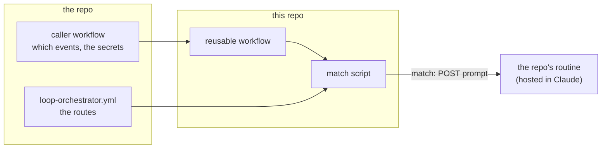
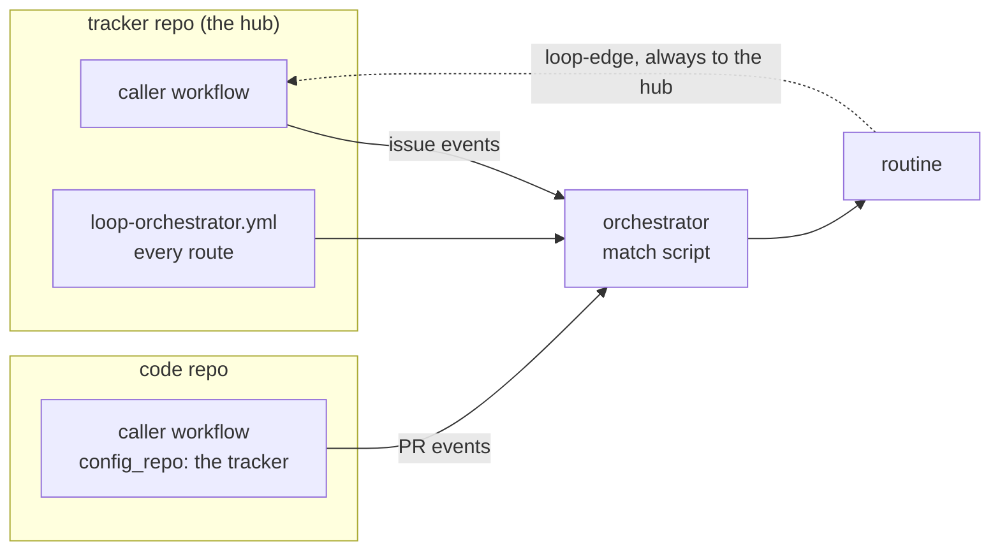

# Design

How the orchestrator works, what it owns, and what it leaves to each repo. Anything marked
**unverified** is a belief that the proof has to check.

## Contents

1. [Rules the design keeps](#1-rules-the-design-keeps)
2. [The pieces](#2-the-pieces)
3. [The config](#3-the-config)
4. [Matching](#4-matching)
5. [The prompt](#5-the-prompt)
6. [Loops triggering loops](#6-loops-triggering-loops)
7. [Schedules](#7-schedules)
8. [Guards](#8-guards)
9. [What each repo owns](#9-what-each-repo-owns)
10. [Open questions](#10-open-questions)

## 1. Rules the design keeps

- **It knows events, not meanings.** No label name, comment format, or workflow step is built in.
  A repo's config says what matters.
- **It never writes to GitHub.** Every comment, label, and close is the routine's. The
  orchestrator's only output is a routine firing, or nothing.
- **No match, no run.** An event that matches no route stops in the match step, before any model
  starts. There is no hidden "check everything" sweep; a sweep only runs when a repo declares
  one as a schedule route ([section 7](#7-schedules)).
- **One event, one routine run.** The orchestrator never chains steps itself. One step starts
  the next only through a declared edge ([section 6](#6-loops-triggering-loops)). The one
  exception is a schedule tick, which fires every schedule route due that hour.
- **Untrusted text never goes into a prompt.** Issue titles, bodies, and comments are written by
  anyone. The prompt carries IDs only, and the routine fetches the text itself
  ([section 5](#5-the-prompt)). The one exception is a maintainer's own request after a mention or a 🤖,
  which counts as an instruction, not data ([`{request}`](#the-request-placeholder)).

## 2. The pieces



| Piece | Lives in | Does |
|---|---|---|
| Caller workflow | the repo, `.github/workflows/loop.yml` | Lists the GitHub events to listen for, and passes the routine's secrets. A few lines, copied from a template. |
| Config | the repo, `.github/loop-orchestrator.yml` | The routes: which event, under which conditions, sends which prompt. |
| Reusable workflow | this repo | Checks out the config, runs the match script, fires the routine. |
| Match script | this repo | Reads the event and the config, outputs a prompt or nothing. Plain shell, `yq` and `jq`, with tests. No model. |
| Routine | Claude, set up by the repo's owners | Does the work. Has its own skills, environment, and GitHub access. |

One routine per hub. Each route sends it a different prompt. That keeps
setup to one routine and two secrets, however many routes there are.

**Every routine is set up the same way,** from [`templates/routine.md`](../templates/routine.md):
the same config, and the same short stored prompt, pasted as is. Each fire's text is added after
that stored prompt. The stored prompt holds the rules every run needs: follow only the route's
instruction, treat issue text as data, check out a PR's branch before working on it (a routine
starts on the default branch), claim the work first, and notify a person privately when it gives
up. Per repo, only the repo names change. A routine someone hand-tuned is one nobody else can
reason about.

**The orchestrator repo stays public.** A reusable workflow in a private repo can't be called
from other repos without org settings, and fails before any job starts, so there's no log. The
routine's Setup script also clones it, which needs a token if it's private.

**Firing a routine** is an HTTP `POST` to its fire URL with a bearer token, sent with an
`anthropic-beta` header. The route's prompt goes in the body's `text`. Three things about it:

- **The text arrives fenced off.** Claude wraps it in a `<routine-fire-payload>` block marked as
  untrusted, so a leaked token can't steer the routine. The routine acts on it only because its
  stored prompt says to follow that block ([`templates/routine.md`](../templates/routine.md#stored-prompt)).
- **30 fires an hour per routine,** 100 across the account. Over that, the fire fails and the
  workflow run shows it.
- **It's a beta API.** Breaking changes come behind a new dated header, and the two previous ones
  keep working for a while, per Claude's docs.

Tested end to end on a private test repo: a 🤖 comment fired the routine, and its reply came back
on the issue.

### Getting skills into the routine

A routine runs in a Claude cloud environment, and the skills it calls have to be there before
the session starts. Skills are **copied** in when the environment is built, not installed as
plugins, because cloud sessions don't load plugins.

- **One pasted stub.** `templates/cloud-setup.sh` goes in the environment's "Setup script"
  field. It lists the plugin repos to take skills from, clones the orchestrator, and runs
  `scripts/cloud-skill-sync.sh`. The real logic lives in this repo and changes by PR, so the
  pasted text rarely changes.
- **What gets copied:** every `plugins/*/skills/<name>/` and top-level `skills/<name>/` into
  `~/.claude/skills/`, and every agent into `~/.claude/agents/`. A source repo's own `.claude/`
  folder is left out, since those are its private tools.
- **The code repo's own skills load by themselves,** because the routine checks that repo out.
- **Skills lose their plugin prefix.** A prompt says `/issue-triage`, not
  `/my-plugin:issue-triage`. Two sources with a skill of the same name: the later one
  wins, and the log says so.
- **Hooks don't come along.** A copied skill doesn't register its plugin's hooks. The script
  warns when a source has any, and when a skill relies on `CLAUDE_PLUGIN_ROOT`, which is only set
  for an installed plugin.
- **Refreshing is manual.** The environment is cached, and only a change to the Setup script's
  text rebuilds it. Bump the stub's `# rebuild:` number to pick up newer skills.
- **The build never fails.** A session with some skills beats none. A session can't see the
  build log, so the script writes `~/loop-setup.log` and `~/loop-env-manifest.md` (what got
  installed, from which commit), which a session can read.
- **Stacks are optional and separate.** SDKs and databases are turned on at the bottom of the
  stub. The matcher knows nothing about them. One ships here, `stacks/umbraco/`: it installs
  the .NET SDK, can cache a SQL Server image, and puts `run-umbraco.sh` in `~/.loop/` so a
  session can start a site and wait for it. It adds an "Umbraco" section to the manifest that
  says what's really installed, so a run reports a missing SDK as blocked, not failed.
- **Allowed domains:** the environment needs `github.com` to clone, plus whatever each stack's
  header lists. Changing them doesn't rebuild the environment by itself.
- **The orchestrator's own skills come first.** The stub always copies this repo's `skills/`
  (today, `loop-notify`) before the `SKILL_SOURCES`, so a source can replace one by shipping a
  skill with the same name.

Checked against a real plugin repo with 39 skills and 3 agents: everything copied, with no
warnings. **Unverified:** that a routine's session finds copied skills by bare name.

### When issues and code live in different repos

By default the issues and the code are in the same repo, and nothing needs setting. When they're
not, one job crosses both: the issue is in the tracker, but the fix, its PR, and the review are
in the code repo. Two separate configs would split that job's graph where the repos meet. So
one config, the **hub**, handles events from both.



**The hub lives in the tracker repo.** Its config says where the code is:

```yaml
code_repo: umbraco/Umbraco.Forms
```

- **Both repos have a caller workflow.** The tracker's reads its own config, as usual. The code
  repo's passes `config_repo: umbraco/Umbraco.Forms-Issues` (say), so its events are matched
  against the hub's config instead of one of its own. The code repo has no config file.
- **Only listed repos may send events.** The hub accepts events from itself and from any repo its
  config names in `code_repo`. An event from anywhere else stops, so a stranger can't point a
  caller at your hub.
- **A route can say which repo it's for.** The condition `in: tracker` or `in: code` limits it to
  events from that repo. Without it, a route matches events from either. Issue routes usually
  want `in: tracker`, since a code repo with its own issues turned on would otherwise match
  them too.
- **The prompt gets all three repos.** `{repo}` is where the event happened, `{tracker_repo}` is
  the hub, and `{code_repo}` is where the code is ([section 5](#5-the-prompt)). With one repo,
  all three are the same.
- **A PR knows its issue.** For PR events, `{linked_issue}` is the issue the PR says it closes
  ("Closes owner/tracker#123"), read from GitHub. That's what lets a PR route hand back to the
  issue. **Unverified:** that GitHub's closing-reference lookup returns issues from another
  repo.
- **Edges always go to the hub.** A routine fires `loop-edge` at the tracker repo, whichever repo
  it was working in. The edge payload names the repo and number it's about, so an edge can start
  a PR route from an issue route, or the other way round.
- **"Maintainer" means write access to the repo where the event happened.** Approving an issue
  needs write access to the tracker. Approving a PR needs write access to the code repo.
- **One route can point at another code repo.** A route may set its own `code_repo`, for a
  tracker that serves more than one. That repo is then also allowed to send events. Picking the
  code repo from a label (`area/forms` goes to Forms) is a later step, if a real tracker needs
  it.

**The usual case: a public tracker, and code that's public or private.**

- **Reading the hub is free.** A public tracker's config can be read from any workflow, so the
  code repo's caller needs no extra token. Only a private tracker would need one.
- **A private code repo behind a public tracker can leak.** The routine reads private code, then
  writes on a public issue. File paths, class names, and code snippets in a comment are a leak
  of the code. The orchestrator can't stop that, since it never sees what's posted. But it can
  say so: `{code_private}` is `true` when the code repo is private, read from GitHub. A prompt
  passes it on, and the repo's skills decide what to leave out
  ([section 9](#9-what-each-repo-owns)).
- **The private repo's name stays out of public logs.** The hub's workflow runs in the public
  tracker, so its logs are public. When the code repo is private, the orchestrator logs the route
  name and the issue number, never the code repo's name or a PR number from it.

**What it costs:**

- **Reading a private hub.** Rare, but if the tracker is private, the code repo's workflow needs
  a token with read access to it, as a secret in the code repo.
- **The routine needs access to both repos:** issues and labels on the tracker, and the code repo
  to read, run, and later open PRs in. **Unverified:** how a hosted routine is given more than
  one repo. The routine's config lists both as sources (`templates/routine.md`).
- **The config is away from the code.** Someone working in the code repo has to know the routes
  live in the tracker. The code repo's caller workflow names it, so that's the first place to
  look.

## 3. The config

One file, `.github/loop-orchestrator.yml`. A sketch of its shape:

```yaml
version: 1
bots: ["claude[bot]"]
max_hops: 5
# code_repo: owner/other-repo   # only when issues and code live apart

routes:
  - name: new-issue
    when: issues.opened
    if:
      lacks_label: ["status/*"]
    prompt: >-
      Triage issue {number} in {repo}.
      Route: {route}.

  # A maintainer's reply is how they correct the routine.
  - name: maintainer-reply
    when: issue_comment.created
    if:
      has_label: [awaiting-reply]
      actor: maintainer
    prompt: >-
      Issue {number} in {repo}: a maintainer replied (comment {comment_id}).
      Route: {route}.

  - name: asked-directly
    when: issue_comment.created
    if:
      mentions: [claude]
      actor: maintainer
    prompt: >-
      A maintainer mentioned you on issue {number} in {repo}.
      Do what they asked: {request}
      Route: {route}.

  - name: investigate
    when: edge
    allow_from: [new-issue, maintainer-reply]
    prompt: >-
      Investigate issue {number} in {repo}. This was hop {hop}.
      Route: {route}.
```

The label names above are only an example. The orchestrator treats them as strings to match.

- **`name`** identifies the route. It's what edges point at, and it goes into the prompt so the
  routine knows why it was started.
- **`when`** is one event from a closed list ([section 4](#4-matching)). An unknown event is an
  error, not a route that quietly never fires.
- **`if`** holds conditions. All must pass.
- **`prompt`** is a template. Only the placeholders in [section 5](#5-the-prompt) are allowed.
- **`bots`** lists extra logins to treat as bots, on top of GitHub's own `Bot` type.
- **`routine_login`** names the account the routine posts as, when that's a person's. Its events
  only count when addressed ([section 4](#addressing-the-routine)).
- **`code_repo`** says where the code lives, if not here. Optional, at the top or on one route.
  Setting it makes this config the hub for that repo's events too
  ([section 2](#when-issues-and-code-live-in-different-repos)).
- **The first matching route wins.** One event, one run.

### Why YAML, and its traps

YAML because prompts are long text, and YAML's `>-` lets them span lines without quotes or
`\n`. It also allows comments, and it matches the workflow files beside it in `.github/`.

- **The key is `when`, not `on`.** Some YAML parsers read a bare `on` as the value `true`.
  GitHub's own workflow files have the same problem.
- **Quote anything with `*` in it.** A bare `*` at the start of a value means something else in
  YAML. `"status/*"` is safe; `status/*` unquoted may not be.
- **The workflow turns it into JSON with `yq`,** then the match script (Node, no packages)
  reads that. GitHub's Ubuntu runners include `yq` (confirmed in this repo's CI). On a runner
  without it, the workflow stops with an error rather than download an unpinned copy.

The match script checks the config itself (`src/config.mjs`) and rejects one with any error. A
broken config fails the workflow loudly: a silently ignored config means routines stop firing and
nobody notices. YAML makes this check matter more, since a wrong indent can move a condition to
the wrong route without any error from the parser.

`schema/loop-orchestrator.schema.json` is for editors, so a repo gets autocomplete and early
warnings. The script's own checks are the ones that count, and they go further than the schema
can: unknown placeholders, `{request}` outside a mentions route, `allow_from` naming a route
that doesn't exist.

## 4. Matching

### Events

A closed list. Each is a GitHub event and action, written `event.action`:

| `when` | Fires when |
|---|---|
| `issues.opened` | an issue is opened |
| `issues.labeled` | a label is added to an issue |
| `issue_comment.created` | a comment is posted on an issue |
| `pull_request.opened` | a PR is opened |
| `pull_request.labeled` | a label is added to a PR |
| `pr_comment.created` | a comment is posted on a PR (GitHub sends these as `issue_comment` too; the script tells them apart) |
| `edge` | a routine started the next step ([section 6](#6-loops-triggering-loops)) |
| `schedule` | an hourly tick, when the route's `cron` is due ([section 7](#7-schedules)) |

Adding an event later is a change to this list, the schema, and the tests.

### Conditions

| Condition | Passes when |
|---|---|
| `label` | the label just added matches (for `*.labeled`) |
| `has_label` | the issue or PR has at least one of these labels |
| `lacks_label` | it has none of these labels |
| `actor` | who caused the event: `maintainer` (write access or above), `author` (opened the issue or PR), `maintainer_or_author`, or `anyone` |
| `comment_starts_with` | the comment begins with this text, such as `/retry` |
| `mentions` | the comment, or the body of a newly opened issue or PR, mentions one of these logins, such as `claude` |
| `addressed_with` | the comment, or the body of a newly opened issue or PR, starts with one of these prefixes, such as `🤖` ([below](#addressing-the-routine)) |
| `state` | `open` or `closed` |
| `in` | which repo the event came from: `tracker` or `code` ([section 2](#when-issues-and-code-live-in-different-repos)) |

A label pattern may end in `*` to match a prefix, like `status/*`. Nothing else is a pattern.

### Mentions

`mentions: [claude]` passes when the text has `@claude` as a whole word, anywhere in it. It works
on `issue_comment.created`, `pr_comment.created`, and on the body for `issues.opened` and
`pull_request.opened`.

- **Quotes and code don't count.** Lines starting with `>` and anything inside backticks or a
  fenced code block are skipped. Otherwise quote-replying to someone's `@claude` comment would
  start a run by accident, and so would a code sample that happens to contain it.
- **Whole word only.** `@claude` matches; `@claude-fan` and `email@claude.example` don't.
- **Edits don't count.** Only a new comment or a new issue fires. Adding `@claude` while fixing a
  typo in an old comment starts nothing, and neither does editing a comment that already had one.
- **Only maintainers can call it.** A route with `mentions` must also say `actor: maintainer`, and
  the schema rejects one that doesn't. A mention from anyone else starts nothing, so a stranger
  can't use `@claude` to put words in front of the routine.
- **The request is captured.** The text after the mention goes to the prompt as `{request}`
  ([section 5](#the-request-placeholder)).

**Mentions need the routine to have its own account.** While the routine posts as a person
(see below), use `addressed_with` instead. If a mention route is added later, leave out the
Claude app's own `@claude` workflow, or one mention gets two replies.

### Addressing the routine

A routine posts through the Claude GitHub app with the account of the person who set it up,
not as a bot. A test on a real repo showed its comments under that person's login, marked "via
Claude." So by login alone, the orchestrator can't tell the routine from that person. Two
settings handle it:

- **`routine_login`** names the account the routine posts as. Every event from that account is
  ignored, comments and labels alike, unless it addresses the routine.
- **`addressed_with: ["🤖", ":robot:"]`** is how a person addresses it: their comment starts with
  one of the prefixes. The routine is told never to start a comment that way, so it can't
  address itself.

The rules:

- **The first line that counts must start with the prefix.** Blank lines, quotes, and code
  blocks above it are skipped, so a quote-reply followed by `🤖 approve` works. `Thanks 🤖
  approve` doesn't, and neither does a 🤖 on a later line.
- **Claude Code's sign-off isn't addressing.** Claude Code often signs what it writes with
  "🤖 Generated with Claude Code." A comment whose first line is that sign-off doesn't count.
  It usually comes last anyway, where it never counts.
- **Maintainer-only.** A route with `addressed_with` must also say `actor: maintainer`.
- **The rest is the request.** Everything after the prefix goes to the prompt as `{request}`,
  as for mentions. The orchestrator doesn't parse it, so a typo can't stop a match; the model
  reads it.
- **Use mentions or `addressed_with` on a route, not both.**
- **Labels are best kept as outputs.** A route that starts from a label can't tell the routine's
  label changes from the person's. With `routine_login` set those are ignored anyway, but so are
  that person's own label changes. Approving with a 🤖 comment avoids the question.
- **A side effect:** an issue opened from the `routine_login` account isn't routed unless its body
  starts with the prefix.

If the routine later gets its own identity (a GitHub App or a machine user), set `routine_login`
to that login, or put it in `bots`. Mentions then become an option too.

**`maintainer` means write access**, checked with GitHub's
`collaborators/<login>/permission` API. A comment's `author_association` isn't enough on its own:
`MEMBER` means a member of the org, which doesn't always mean write access to this repo.

**Bots never match**, whatever the route says. An event whose sender has GitHub's `Bot` type, or
appears in `bots`, stops before matching. The ways in for a routine are an edge, and, from its
`routine_login`, a comment addressed to it.

## 5. The prompt

The prompt is the only thing a routine receives. It's built from the route's template, filling
in a fixed set of placeholders:

| Placeholder | Value |
|---|---|
| `{repo}` | where the event happened, as `owner/name` |
| `{tracker_repo}` | the hub; the same as `{repo}` with one repo |
| `{code_repo}` | where the code lives; the same as `{repo}` unless `code_repo` is set |
| `{code_private}` | `true` if the code repo is private, else `false` |
| `{linked_issue}` | for PR events, the issue the PR says it closes, as `owner/name#123`; empty if none |
| `{number}` | the issue or PR number |
| `{kind}` | `issue` or `pr` |
| `{route}` | the route's name |
| `{event}` | the `when` value that matched |
| `{label}` | the label just added, if any |
| `{actor}` | the login that caused the event |
| `{actor_role}` | `maintainer`, `author`, or `other` |
| `{comment_id}` | the comment's ID, if any |
| `{hop}` | how many edges led here (0 for a GitHub event) |
| `{next_hop}` | `{hop}` plus one: the hop to send with the next edge |
| `{request}` | what a maintainer asked for after a mention or prefix; only in `mentions` and `addressed_with` routes ([below](#the-request-placeholder)) |
| `{time}` | for schedule routes, the hour it ran for, like `2026-10-19T07:00Z` |

There's deliberately no placeholder for a title, body, or general comment text. Anyone can write
those, and text pasted into a prompt can try to steer the model. The routine fetches them itself,
where its own skills can treat them as data.

### The request placeholder

When a maintainer writes `@claude look at the null check in the save handler`, the routine
should know exactly that was asked, without guessing which part of a long comment was meant for
it. `{request}` carries it.

**What gets captured:**

- **Start:** right after the first `@<login>` from the route's `mentions` that isn't in a quote or
  code.
- **Stop:** at the end of the comment, or at a line that starts with a different `@mention`,
  since that's usually a note to someone else.
- **Skipped inside it:** quoted lines and fenced code blocks, by the same rule as the mention
  check. Inline code is kept, since a maintainer naming `SaveHandler` means it.
- **Trimmed:** leading and trailing spaces. An empty request (just `@claude`) gives an empty
  `{request}`, and the routine falls back to reading the whole comment.
- **Capped:** at a few thousand characters. Anything longer is cut, and the prompt says so.

For example:

```markdown
> @claude earlier you said this was a duplicate      <- quoted, skipped
Thanks both.

@claude this isn't a dupe of #41, the stack trace is different. Please triage it again.
Also check the 13.x branch.

@sam can you confirm the CMS version?                <- a different mention, stops here
```

`{request}` is: `this isn't a dupe of #41, the stack trace is different. Please triage it again.
Also check the 13.x branch.`

**Why this is allowed when other text isn't:**

- A maintainer wrote it, and only a maintainer's mention can match. It's their instruction.
- The schema rejects `{request}` in any route without `mentions`, and every `mentions` route
  needs `actor: maintainer`. A reporter's or stranger's words never reach it.
- **The risk left over:** a maintainer pastes someone else's words without quoting them. That's
  small, and their call. The prompt still says where the request came from, so the routine can
  check it against the comment.

The orchestrator wraps it in the prompt so it can't be mistaken for the route's own text:

```text
A maintainer (@{actor}) asked, in comment {comment_id}:
<request>
...
</request>
```

The orchestrator also adds one fixed line to every prompt: re-check the issue or PR still
qualifies before acting, and stop quietly if not. A label can be removed, or an issue closed,
between the event and the run.

## 6. Loops triggering loops

The long-term goal is a graph: each route is a node, and one step's result can start the next.

### Edges are declared, never implied

A routine's own labels and comments never start anything, because bot events are always dropped
([section 4](#4-matching)). That stops a routine waking itself by accident.

To start the next step on purpose, the routine sends GitHub a `repository_dispatch` event of
type `loop-edge`, with this payload:

```json
{ "route": "investigate", "from": "new-issue", "repo": "owner/tracker", "number": 123, "hop": 1 }
```

The orchestrator accepts it only if:

- the target route has `when: edge`,
- its `allow_from` lists the route it came from,
- and the hop count is no more than `max_hops` (5 if not set).

`hop` counts the edges in the chain, this one included, so the first edge sends `1`. A route's
prompt gets `{next_hop}` to pass on, so the routine never has to add one itself.

Otherwise it stops and logs why. `repository_dispatch` starts a workflow even when sent with the
basic `GITHUB_TOKEN`
([GitHub docs](https://docs.github.com/en/actions/concepts/security/github_token)), so edges
don't depend on which token the routine has.

### Rules for the graph

- **The config is the graph.** Adding a step means adding a route. A routine doesn't need to know
  what comes after it, only which edge to fire.
- **Cycles are capped.** Every edge carries a hop count, and the orchestrator stops at the cap.
  Without it, two routes that disagree can bounce an issue forever.
  - **Weak spot:** the routine reports the hop count, so a buggy routine could reset it. A
    stronger check would count the orchestrator's own recent runs for that issue. Not built
    yet: GitHub's runs API doesn't filter by issue, so it needs a record the orchestrator keeps
    itself.
- **Edges can't read a private code repo.** The hub's workflow token only reaches the hub. An
  edge about a PR in a private code repo can't look up that PR, so it stops. Edges about tracker
  issues work.
- **One edge per run.** A run fires at most one edge. Fan-out waits for a real need.
- **People stay on the risky edges.** The orchestrator can't tell risky from safe, since it
  doesn't know what routes do. So this is guidance for each repo's config: an edge into anything
  that writes code, merges, or releases should be `issues.labeled` with `actor: maintainer`,
  never `edge`.

## 7. Schedules

Some work isn't about one issue: a weekday reminder about proposals nobody answered, a weekly
sweep for stale issues. A schedule route covers that.

```yaml
- name: stale-drafts
  when: schedule
  cron: "0 7 * * 1-5"   # 07:00 UTC, Monday to Friday
  prompt: >-
    List the open issues in {repo} that have waited more than 5 days for a maintainer...
```

### How it's triggered

Once an hour, something sends the hub an event. The matcher fires every schedule route whose
`cron` is due that hour. Two things can send it:

| Source | How | When to use it |
|---|---|---|
| **The ticker** (default) | a tiny routine on Claude's own hourly schedule sends each hub a `loop-tick` dispatch event | public repos |
| **GitHub's timer** | the caller workflow's `schedule:` trigger, every hour | private repos |

**Why a ticker at all:** in a public repo, GitHub turns scheduled workflows off after 60 days
without "repository activity," and its docs don't say what counts. If issues and comments don't,
a busy tracker that's rarely committed to loses its timer without warning. A `loop-tick` is a
dispatch event, which that rule doesn't cover. Setting up the ticker is in
[`templates/routine.md`](../templates/routine.md#the-ticker).

**Anything else that can make an HTTP call an hour** can send the tick too: a private repo's
GitHub timer, a cloud scheduler, a cron job. [`docs/TICK-SOURCES.md`](TICK-SOURCES.md) compares
them. The token each one holds can push code to the hub, so where it lives matters more than
which timer it is.

**Use one source, not two.** Two sources firing means each due route runs twice.

### Rules

- **Hourly, at most.** The minute in `cron` must be `0`. Ticks can arrive late, so the matcher
  matches by the hour, not the minute.
- **UTC.** `0 7 * * *` is 07:00 UTC, whatever the repo's timezone.
- **Every due route fires.** Unlike other events, a tick can start several runs, one per due
  route. Each fire is separate; one failing doesn't stop the rest.
- **No conditions, and only repo-wide placeholders.** A scheduled run has no issue, PR, or
  person, so `if` is rejected, and so are `{number}`, `{actor}`, and the like. It gets `{repo}`,
  `{tracker_repo}`, `{code_repo}`, `{code_private}`, `{route}`, `{event}`, and `{time}`, the hour
  it ran for, like `2026-10-19T07:00Z`.
- **Only in the hub.** A tick or timer in a code repo is ignored, so a split setup can't run a
  schedule twice.
- **No edges out.** An edge carries one issue, and a scheduled run has none, so an edge route
  can't list a schedule route in `allow_from`.
- **A missed hour is skipped, not caught up.** The matcher only knows the current hour. A route
  due at 07:00 whose tick never came doesn't run at 08:00.
- **Its prompt ends differently.** Instead of the re-check for one issue, a scheduled prompt
  ends with: this is about the whole repo, and if there's nothing to do, stop quietly.

## 8. Guards

All of these work without knowing what any route does.

- **Bots never match** ([section 4](#4-matching)), and the routine's own account only counts
  when addressed ([section 4](#addressing-the-routine)).
- **One routing run per issue or PR at a time.** A `concurrency` group keyed on the repo and the
  number queues a second event rather than racing the first. The repo is part of the key because
  a hub sees issue #12 from the tracker and PR #12 from the code repo, and those mustn't block
  each other.
  - **This doesn't stop two routine runs overlapping.** The routine runs after the fire, outside
    the workflow, so two quick events can start two runs on one issue. Two things cover it:
    the routine **claims** the item before doing real work, usually by
    changing a label, and every prompt ends with a **re-check** that stops a run whose item no
    longer qualifies. A second run sees the first one's claim at its re-check and stops. The
    claim has to be the run's first action, not its last, or it guards nothing.
  - **GitHub keeps only one waiting run per group.** A third event while one runs and one waits
    replaces the waiting one. Routing takes seconds, so this should be rare.
- **Who's a maintainer fails closed.** If GitHub's permission check errors, the actor is treated
  as not a maintainer. **Unverified:** that the workflow's basic token may call the
  `collaborators/<login>/permission` endpoint. If it can't, every maintainer route stops
  matching, and the log says why.
- **Hop cap** on edges ([section 6](#6-loops-triggering-loops)).
- **No untrusted text in prompts** ([section 5](#5-the-prompt)).
- **A broken config fails loudly** ([section 3](#3-the-config)).
- **Retries are safe.** A fire that fails with a server error is retried a few times. The
  routine's re-check line ([section 5](#5-the-prompt)) means a duplicate fire stops quietly.
- **Public logs say little.** On a public repo, Action logs are public. The orchestrator logs the
  route name and why it matched, never issue text.

## 9. What each repo owns

The orchestrator stays generic by pushing everything else to the repo. That's a lot, so it's
listed here:

- **What labels mean,** and which ones a person sets.
- **What the routine posts,** and in what format.
- **How it treats issue text.** A routine reads text anyone can write. The repo's skills decide
  how much the model can do with it. A routine that can post freely can be steered into posting
  something odd. Giving the routine as few write tools as it needs is the repo's job.
- **Keeping private code out of public comments.** With a public tracker and private code, the
  orchestrator passes `{code_private}`, but what to leave out of a comment is the repo's call.
- **How a run claims its item.** The orchestrator can't, since it doesn't know what labels mean.
  Each route's skill does, as its first step ([guards](#8-guards)).
- **Security reports.** If an issue reads like a vulnerability, the routine must not discuss it
  in public. The orchestrator can't spot one, since it never reads the text. The routine tells a
  maintainer privately instead.
- **When to notify.** The orchestrator ships the `loop-notify` skill, which sends a Claude push
  notification, never fails the work, and in private mode never falls back to a public comment
  ([`templates/routine.md`](../templates/routine.md#notifications)). When to call it (a possible
  security report, a run that gave up) is the repo's skills' call. A repo that wants Slack ships
  its own `loop-notify`. The orchestrator never notifies anyone itself.
- **The routine's environment:** its skills, any SDKs, how it builds and runs the product.
- **Cost:** how big a model each prompt uses, and how many turns.

The [example](../examples/triage/) shows one repo's answers.

## 10. Open questions

1. **A routine of its own identity.** Tested: a routine posts as the person who set it up,
   through the Claude app. `routine_login` and `addressed_with` make that safe. A dedicated
   identity (a GitHub App or a machine user) would put its comments under its own name and allow
   mentions. **Unverified:** how a hosted routine is given its own GitHub credentials
   ([`templates/routine.md`](../templates/routine.md#if-those-permissions-are-too-much-or-you-want-a-real-bot)).
